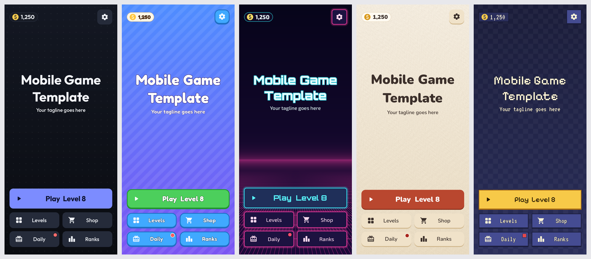
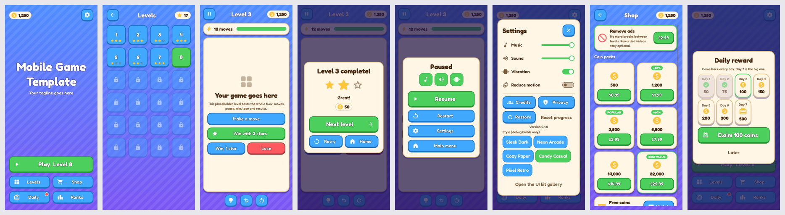
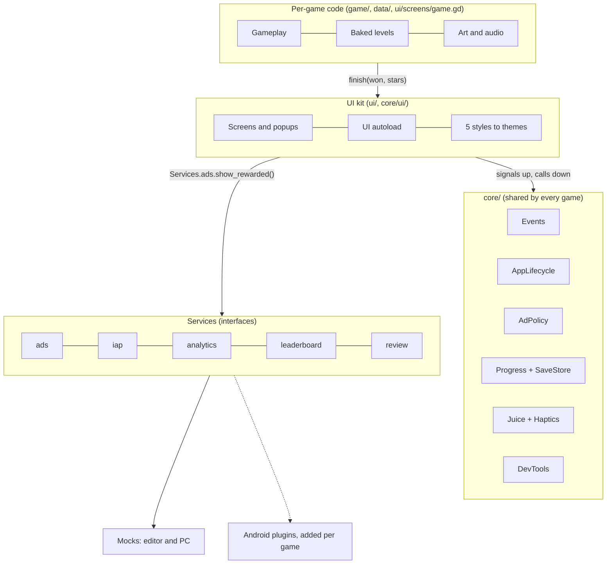

# Mobile Game Template

A reusable **Godot 4.7.2** template for small 2D portrait games on Android, built to be developed
with **Claude Code**. Every new game starts from this repo, so each one only adds gameplay, data
and art. It ships a complete **mobile UI kit**: fourteen screens and popups in **five visual
styles**, responsive from small phones to tablets.





| | |
|---|---|
| Engine | Godot 4.7.2 stable, GDScript, Compatibility renderer |
| Target | Android first, portrait, target API 36, AAB for Google Play |
| UI | 5 styles (Sleek Dark, Candy Casual, Neon Arcade, Cozy Paper, Pixel Retro), 14 screens and popups, WCAG AA contrast and 48 dp touch targets checked by tests |
| Tests | GUT 9.7.1, 67 tests (491 checks), one-command check (`tools/check.ps1`), screenshot tool for every screen × style × size |
| AI workflow | `CLAUDE.md` rules, an auto-check hook, 6 project skills, tools that let Claude edit scenes safely and look at the UI |

## Documentation

| Guide | Read it when |
|---|---|
| [Getting started](docs/GETTING_STARTED.md) | Setting up a PC, running on a phone, the daily loop, learning Godot |
| [UI kit](docs/UI_KIT.md) | Screens, styles, making your own style, adding screens and popups, layout rules |
| [Architecture](docs/ARCHITECTURE.md) | What every part does, its API, and why it was built that way |
| [Customizing](docs/CUSTOMIZING.md) | Starting a new game: what to change, what you may change, what to leave alone |
| [Services and backend](docs/SERVICES.md) | Ads, purchases, leaderboards, analytics, and adding the real SDKs |
| [Accessibility](docs/ACCESSIBILITY.md) | What is built in, what each game must do, known gaps |
| [Working with Claude Code](docs/CLAUDE_CODE.md) | The rules, the auto-check hook, the skills, and how to prompt |
| [Testing and debugging](docs/TESTING_AND_DEBUGGING.md) | Tests, screenshots, the debug console, phone debugging, exports |

## What's included

| Part | Where | What it does |
|---|---|---|
| Screens | `ui/screens/` | Splash, main menu, level select, game (HUD + placeholder board), shop, credits (with licence notices), UI kit gallery |
| Popups | `ui/popups/` | Pause, results (win/lose with rewarded continue), settings, daily reward, ranks, confirm |
| Styles | `core/ui/styles/`, `core/ui/themes/`, `tools/build_theme.gd` | Five styles as Inspector-editable resources, built into themes; switch with one setting |
| UI services | `core/ui/ui.gd` (autoload `UI`) | Screen fades, popups with a Back stack, toasts, confirm dialogs, button press feel + haptics, focus rings for keyboard/gamepad only |
| Layout | `core/ui/` | Safe-area (notch) margins, max-width columns for tablets, adaptive grids, animated backgrounds |
| Widgets | `core/ui/widgets/`, `core/ui/icons.gd` | Star rating, coin counter with count-up, level tile; 38 Material Symbols icons |
| Progress | `core/progress.gd` | Stars per level, unlocks, coins, purchases, 7-day daily reward streak (JSON save) |
| Settings | `core/settings.gd` | Music and sound volume, vibration, reduce motion |
| Signal bus | `core/events.gd` (autoload `Events`) | Level, results, rewards, `app_paused`, `back_requested`, debug commands |
| Services | `core/services/` (autoload `Services`) | Ads, purchases, analytics, leaderboards and reviews behind interfaces, with mocks |
| Lifecycle | `core/app_lifecycle.gd` (autoload `AppLifecycle`) | Android pause/resume/Back to signals; applies the player's feel settings |
| Ad rules | `core/ad_policy.gd` | Interstitials only on a results screen, never in the first session, capped and spaced |
| Seeds, save | `core/seed_service.gd`, `core/save_store.gd` | Stable SHA-256 seeds; versioned JSON save with crash-safe writes |
| Feel | `core/feel/` | `Juice.pop/squash`, `Haptics`, a hit-flash shader, all respecting player settings |
| Dev tools | `core/dev_tools.gd` + LimboConsole | Debug builds only: console, FPS overlay, input log, notch simulation |
| Tools | `tools/` | `check.ps1`, `snapshots.ps1` (renders every screen), `build_theme.gd`, `scene_edit.gd` (safe scene edits) |
| Android presets | `export_presets.cfg` | Debug APK (30 MB) and release AAB; tests, tools and editor-only addons left out |

Built on [Maaack's Godot Game Template](https://github.com/Maaack/Godot-Game-Template) v1.7.0 (MIT)
for the scene loader, music and UI-sound controllers, config storage and the credits
parser. The menus are the template's own.

## Architecture at a glance



Game code talks to interfaces, never to plugin singletons, so the whole loop runs on PC with mocks
and a plugin can be swapped without touching games. Details: [Architecture](docs/ARCHITECTURE.md).

## Quick start

Requirements: Godot 4.7.2, OpenJDK 17, Android SDK (Platform 36, Build-Tools 36.1.0,
NDK 29.0.14206865), an Android phone with USB debugging. Full steps:
[Getting started](docs/GETTING_STARTED.md).

```powershell
gh repo create my-game --template MehulKumars/godot-mobile-template --private --clone
cd my-game
godot --path . -e                                     # open the editor, F5 to run
powershell -ExecutionPolicy Bypass -File tools/check.ps1
powershell -ExecutionPolicy Bypass -File tools/snapshots.ps1 -Styles all   # look at every screen
godot --headless --path . --export-debug "Android Debug APK" build/game-debug.apk
adb install -r build/game-debug.apk
```

Then follow [Customizing](docs/CUSTOMIZING.md): pick a style, package name, icons, logo, credits,
keystore.

## Project skills

| Skill | Use it for |
|---|---|
| `mobile-ui` | Building or changing screens, popups, HUDs and styles with the UI kit, and checking them |
| `game-design-review` | Ideas and prototypes: first 60 seconds, difficulty, juice level, ads, keep/kill lines, by game type |
| `godot-game-feel` | Juice, VFX, SFX, haptics, with the real cost on low-end Android |
| `level-generation` | Solvable, bot-rated, seeded levels baked to data files |
| `mobile-performance-audit` | Stutter, size, crashes and ANRs on cheap phones |
| `play-release` | Keystore, AAB, closed test, store listing and the pre-release checklist |

## Known gaps

- **Real platform services are not wired yet.** Every service uses its mock (mock ads do nothing in
  release builds; shop prices are placeholders). Add AdMob, Play Billing and Play Games Services when
  the first game needs them: [Services](docs/SERVICES.md).
- **The app icon is the template's placeholder** (a play mark). Each game replaces the files in
  `assets/template_icon/` with its own icon at the same sizes.
- **Credits and splash say "Your Studio" / "Mobile Game Template".** Put your team in `ATTRIBUTION.md`
  and your game name in `project.godot`.
- **No text-size setting or translations yet**, and no screen-reader support until Godot 4.8.
- **Tested on one phone so far** (OnePlus 10R, Mali GPU, Android 15). Test on a low-end Adreno phone
  before a release.
- The auto-check hook needs Windows PowerShell; on macOS or Linux, call `check_script.gd` from a
  shell script instead.

## Licences

Template code in `core/`, `ui/`, `tests/` and `tools/` is yours to use in your games. Fonts are SIL
OFL 1.1 and icons Apache 2.0 (Google Material Symbols); every third-party file is listed in
[ASSETS_LICENSES.md](ASSETS_LICENSES.md). Maaack's MIT licence is kept in `LICENSE.txt` and
`ATTRIBUTION.md`, as it requires.
