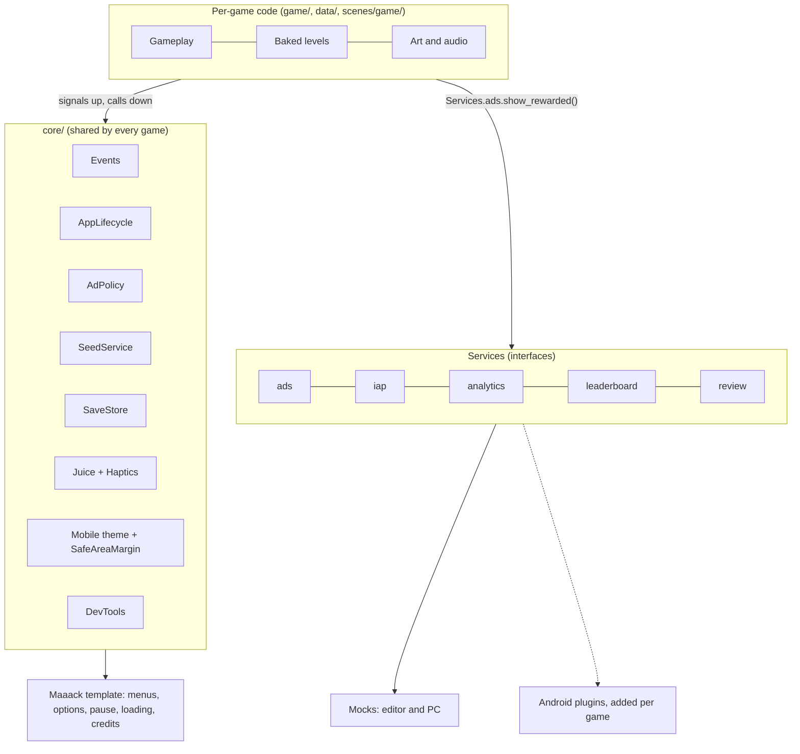

# Mobile Game Template

A reusable **Godot 4.7.2** template for small 2D portrait games on Android, built to be developed
with **Claude Code**. Every new game starts from this repo, so each one only adds gameplay, data
and art.

Built on [Maaack's Godot Game Template](https://github.com/Maaack/Godot-Game-Template) v1.7.0 (MIT),
which provides menus, options, pause, a loading screen, credits, music and UI-sound controllers.

| | |
|---|---|
| Engine | Godot 4.7.2 stable, GDScript, Compatibility renderer |
| Target | Android first, portrait 720×1280, target API 36, AAB for Google Play |
| Tests | GUT 9.7.1, 25 unit tests, one-command check (`tools/check.ps1`) |
| AI workflow | `CLAUDE.md` rules, an auto-check hook, 5 project skills |

## Documentation

| Guide | Read it when |
|---|---|
| [Getting started](docs/GETTING_STARTED.md) | Setting up a PC, running on a phone, the daily loop, learning Godot |
| [Architecture](docs/ARCHITECTURE.md) | You want to know what every part does, its API, and why it was built that way |
| [Customizing](docs/CUSTOMIZING.md) | Starting a new game: what to change, what you may change, what to leave alone |
| [Services and backend](docs/SERVICES.md) | Ads, purchases, leaderboards, analytics, and adding the real SDKs |
| [Accessibility](docs/ACCESSIBILITY.md) | What is built in, what each game must do, known gaps |
| [Working with Claude Code](docs/CLAUDE_CODE.md) | The rules, the auto-check hook, the skills, and how to prompt |
| [Testing and debugging](docs/TESTING_AND_DEBUGGING.md) | Tests, the debug console, phone debugging, exports |

## What's included

| Part | Where | What it does |
|---|---|---|
| Menus and flow | `scenes/` (Maaack) | Main menu, options, pause, loading screen, credits, level won/lost windows, music and UI sounds |
| Mobile setup | `project.godot`, `core/ui/` | Portrait 720×1280, touch from mouse on PC, mobile theme (32 px text, 96 px buttons), notch-safe container |
| Options | `scenes/menus/options_menu/` | Desktop tabs hidden on phones; Game tab with Reduce Motion and Haptics |
| Signal bus | `core/events.gd` (autoload `Events`) | Level, results, rewards, `app_paused`, `back_requested`, debug commands |
| Services | `core/services/` (autoload `Services`) | Ads, purchases, analytics, leaderboards and reviews behind interfaces, with mocks |
| Lifecycle | `core/app_lifecycle.gd` (autoload `AppLifecycle`) | Android pause/resume/Back to signals; applies the player's feel settings |
| Ad rules | `core/ad_policy.gd` | Interstitials only on a results screen, never in the first session, capped and spaced |
| Seeds | `core/seed_service.gd` | Stable SHA-256 seeds for levels and daily puzzles |
| Save | `core/save_store.gd` | Versioned JSON save with crash-safe writes and migrations |
| Feel | `core/feel/` | `Juice.pop/squash`, `Haptics`, a hit-flash shader, all respecting player settings |
| Dev console | `core/dev_tools.gd` + LimboConsole | Debug builds only: `` ` `` on PC, three-finger tap on a phone |
| Android presets | `export_presets.cfg` | Debug APK for phones, release AAB for Google Play; tests and GUT excluded |
| Claude Code | `CLAUDE.md`, `.claude/`, `tools/hooks/` | Rules, auto-check after every `.gd` edit, five skills |

## Architecture at a glance



Game code talks to interfaces, never to plugin singletons, so the whole loop runs on PC with mocks
and a plugin can be swapped without touching games. Details: [Architecture](docs/ARCHITECTURE.md).

## Quick start

Requirements: Godot 4.7.2, OpenJDK 17, Android SDK (Platform 36, Build-Tools 36.1.0,
NDK 29.0.14206865), an Android phone with USB debugging. Full steps:
[Getting started](docs/GETTING_STARTED.md).

```powershell
gh repo create my-game --template MehulKumars/godot-mobile-template --private --clone
cd my-game
godot --path . -e                                     # open the editor, F5 to run
powershell -ExecutionPolicy Bypass -File tools/check.ps1
godot --headless --path . --export-debug "Android Debug APK" build/game-debug.apk
adb install -r build/game-debug.apk
```

Then follow [Customizing](docs/CUSTOMIZING.md): package name, icons, opening logo, credits, keystore.

## Project skills

| Skill | Use it for |
|---|---|
| `game-design-review` | Ideas and prototypes: first 60 seconds, difficulty, juice level, ads, keep/kill lines, by game type |
| `godot-game-feel` | Juice, VFX, SFX, haptics, with the real cost on low-end Android |
| `level-generation` | Solvable, bot-rated, seeded levels baked to data files |
| `mobile-performance-audit` | Stutter, size, crashes and ANRs on cheap phones |
| `play-release` | Keystore, AAB, closed test, store listing and the pre-release checklist |

## Known gaps

- **Real platform services are not wired yet.** Every service uses its mock (mock ads do nothing in
  release builds). Add AdMob, Play Billing and Play Games Services when the first game needs them:
  [Services](docs/SERVICES.md).
- **Volume sliders are thin** (Godot's default slider art), below the 48 dp target. Toggle switches
  have 96 px tap areas but small default art. Restyle both per game.
- **The app icon is a 64×64 placeholder.** Each game needs launcher icons: main at least 192×192,
  adaptive foreground and background at least 432×432.
- **Maaack's demo content is still included:** the opening scene shows the Godot logo, the credits
  screen (built from `ATTRIBUTION.md`) shows the Godot, Git and Maaack logos, and the example game
  has demo levels. Replace them per game.
- **Android Back button:** `AppLifecycle` emits `Events.back_requested`; confirm on a phone that it
  opens the pause menu, and connect it if not.
- The auto-check hook needs Windows PowerShell; on macOS or Linux, call `check_script.gd` from a
  shell script instead.

## Licences

Template code in `core/`, `tests/` and `tools/` is yours to use in your games. Third-party code and
assets are listed in [ASSETS_LICENSES.md](ASSETS_LICENSES.md); Maaack's MIT licence is kept in
`LICENSE.txt` and `ATTRIBUTION.md`, as it requires.
