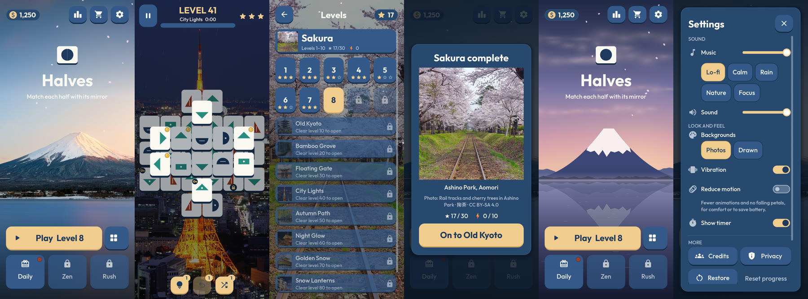

# Halves

**A calm puzzle of mirror halves.** Tap a free tile, then its mirror-cut other half, and the two
snap into one whole shape. Never match twins. Stack-clearing like mahjong solitaire, played over
ten places in Japan, from cherry blossoms to snowy lantern streets, to lo-fi beats or rain.



Made with Godot 4.7 for Android phones (portrait). Version 1 is being shared with friends before a
Google Play closed test.

## How to play

- **Tap a free tile, then its mirror half.** Same shape, same cut and same mark, opposite side.
- **A tile is free** when nothing lies on it and its left or right side is open. Covered tiles look
  darker.
- **Never match twins.** Two left halves (or two halves with different marks) are a mistake.
- **Plan ahead.** A half lying on top of its own mate can never meet it. Getting stuck is allowed
  (a shuffle always gets you out), but it costs a star.
- **Stars:** 3 for a clean clear, 2 for one or two slips (a mistake or a shuffle out of a dead end),
  1 otherwise. Beat the level's **par time** for the ⚡ Swift medal.

New rules arrive one at a time, each with a short card:

| Level | New idea |
|---|---|
| 1-5 | Pairs, stacked layers, open ends, twins, the first trap |
| 6-11 | Horizontal cuts, diamonds, dot and line marks, gold tiles |
| 21 | **Mist:** faces stay hidden until the tile is free |
| 41 | **Locks and keys:** padlocked tiles open when every key tile is cleared |
| 61 | **Frost:** frozen tiles thaw when a tile touching them is cleared |

## What's in version 1

- **100 levels in ten places of ten levels.** Each place has its own wallpaper-quality photo, ambient
  petals, rain, leaves or snow, its own win jingle and burst, and a reveal when its ten levels are done:

  | Levels | Place | Levels | Place |
  |---|---|---|---|
  | 1-10 | Sakura, Ashino Park | 51-60 | Autumn Path, Nara Park |
  | 11-20 | Old Kyoto, Yasaka-dori | 61-70 | Night Glow, Kiyomizu-dera |
  | 21-30 | Bamboo Grove, Arashiyama | 71-80 | Golden Snow, Kinkaku-ji |
  | 31-40 | Floating Gate, Miyajima | 81-90 | Snow Lanterns, Ginzan Onsen |
  | 41-50 | City Lights, Tokyo Tower | 91-100 | Thousand Gates, Fushimi Inari |

  The home screen has its own (Mount Fuji at sunset). Settings can switch every background to a
  **drawn** version of the same place, made in code.
- **Music you pick:** Lo-fi beats, Calm (soft piano and ambient), Rain, Nature (waves, a forest
  stream, crickets at night) or Focus (a soft binaural tone over brown noise).
- **A sawtooth difficulty curve.** Every pack of 10 has a gentle level that brings a new idea, a
  climb, a hard level at 5 and a finale at 10.
- **Modes:**
  - **Daily Puzzle:** the same board for everyone each day, gentle on Monday and hardest on Sunday,
    with a streak and a result to copy.
  - **Zen:** endless calm boards with no clock, stars or ads; opens after level 10.
  - **Rush:** clear as many small boards as you can in three minutes; opens after level 15.
- **A clock that only runs while you play.** Your best time per level is saved with its moves, so a
  future friends leaderboard can check it.
- **Feel:**
  - porcelain-and-wood clacks, combo chains that climb in pitch, shards, and pops as tiles come free;
  - mist flips, padlocks springing open, frost cracking, gold coins;
  - a gentle haptic tick on each snap.
- **Kind to every player:** Reduce Motion (fewer animations and particles), vibration on/off, a
  hideable clock, and shapes that never rely on colour alone. No lives and no fail screen: a board
  can always be finished.

## Build and run

You need Godot 4.7.2, and the Android SDK for phone builds. Steps are in
[Getting started](docs/GETTING_STARTED.md).

```powershell
godot --path . -e                                   # open in the editor (F5 to play)
powershell -ExecutionPolicy Bypass -File tools/check.ps1                  # boot + every test
godot --headless --path . --export-debug "Android Debug APK" build/game-debug.apk
adb install -r build/game-debug.apk                 # put it on a phone
```

Debug builds have **Settings > Developer > Dev mode**: every level open and a Skip button in play,
for testing. Release exports never show it (it checks `OS.is_debug_build()`).

## How it's made

| Part | Where |
|---|---|
| Rules, logic and data contract (the tests are written from it) | [docs/HALVES.md](docs/HALVES.md), `game/halves/` |
| Board view, feel and effects | `game/halves/halves_board_view.gd`, `halves_tile_view.gd`, `halves_snap_fx.gd` |
| Game screen, modes, clock and records | `ui/screens/game.gd`, `game/halves/halves_records.gd` |
| Places, photos, drawn scenes and ambience | `game/halves/halves_chapters.gd`, `chapter_background.gd`, `halves_scenery.gd`, `tools/art/` |
| Sound and music | `core/audio/sound.gd` (autoload `Sound`), `game/halves/halves_music.gd`, `tools/audio/` |
| Levels and daily, zen and rush boards | `tools/levelgen/` → `data/levels/*_v2.json` |

**Levels are generated offline and baked; nothing is made up at run time.**
1. Hand-drawn stack masks plus a plan give each level its role (rest, ramp, hard, finale), its pair
   types and its new feature.
2. A reverse-removal fill makes every board solvable. Trap-seeding then gives some stacked tiles
   mated faces, so careless play can strand a half on top of its own mate.
3. Three bots rate every candidate:
   - **random:** taps any free pair;
   - **careful:** frees the most tiles;
   - **wary:** a human-like player who avoids obvious traps.
4. The candidate closest to the level's target wins. Hard levels and finales must still be fair for
   the wary bot.

```powershell
powershell -ExecutionPolicy Bypass -File tools/levelgen/generate_parallel.ps1   # all levels and pools
godot --headless --path . -s tools/levelgen/generate_halves.gd -- 41           # preview one level
godot --headless --path . -s tools/levelgen/bench_halves.gd                    # timings
```

Reports land in `tools/levelgen/reports/`. Other tools:
- `tools/snapshots.ps1 -Styles halves`: screenshots of every screen.
- `godot --path . -s tools/halves_playtest.gd -- 41`: plays a level with real taps and saves key frames.

Halves is built on the studio's Godot mobile template: a UI kit, services with mocks, ad rules,
saves and the test setup. The template's guides are in [docs/](docs/): [UI kit](docs/UI_KIT.md),
[Architecture](docs/ARCHITECTURE.md), [Services](docs/SERVICES.md),
[Testing](docs/TESTING_AND_DEBUGGING.md).

## Credits

A game by **Mehul Kumar**, built with [Godot Engine](https://godotengine.org) and
[Maaack's Godot Game Template](https://github.com/Maaack/Godot-Game-Template) (MIT).

- **Photos** (Wikimedia Commons, CC0 / CC BY / CC BY-SA): Romain Guy, 掬茶, Basile Morin, Jakub
  Hałun, kakidai, Martin Falbisoner, Takeshi Kuboki and さかおり. Tiles, shapes, effects and the
  drawn backgrounds are made in code.
- **Music:** HoliznaCC0, Purrple Cat, AvapXia, Lee Rosevere, Memoraphile and Matthew C. Wright;
  ambience by Gravity Sound and BigSoundBank (Joseph Sardin, Pierre Sibanarco); focus tones made in code.
- **Sounds (CC0):** [Kenney](https://kenney.nl) Casino Audio, Impact Sounds, Interface Sounds and
  Music Jingles.
- **Fonts and icons:** Outfit (SIL OFL 1.1); Material Symbols (Apache 2.0).

Every third-party file, with its licence and source, is listed in
[ASSETS_LICENSES.md](ASSETS_LICENSES.md). No AI-generated art, music or sound is used.
