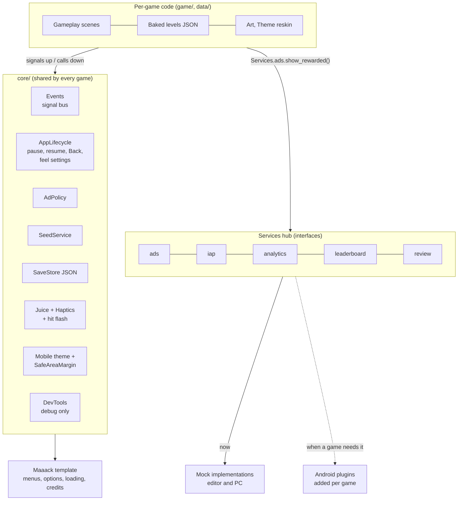

# Mobile Game Template

A reusable **Godot 4.7.2** template for small 2D portrait games on Android, built to be developed with **Claude Code**.
Every new game starts from this repo, so each one only adds gameplay, data and art.

Built on [Maaack's Godot Game Template](https://github.com/Maaack/Godot-Game-Template) v1.7.0 (MIT), which provides
menus, options, a loading screen, credits, music and UI-sound controllers.

| | |
|---|---|
| Engine | Godot 4.7.2 stable, GDScript, Compatibility renderer |
| Target | Android first, portrait 720×1280, target API 36, AAB |
| Tests | GUT 9.7.1, 25 unit tests, `tools/check.ps1` |
| AI workflow | `CLAUDE.md` rules, an auto-check hook, 5 project skills |

## Architecture



Game code talks to interfaces, never to plugin singletons, so the whole loop runs on PC with mocks and a dead
plugin can be swapped without touching games.

## What's included

| Part | Where | What it does |
|---|---|---|
| Signal bus | `core/events.gd` (autoload `Events`) | Systems talk through signals: level, results, rewards, `app_paused`, `back_requested` |
| Services | `core/services/` (autoload `Services`) | Ads, purchases, analytics, leaderboards and reviews behind interfaces, with mocks |
| Lifecycle | `core/app_lifecycle.gd` (autoload `AppLifecycle`) | Android pause/resume/Back to signals; applies Reduce Motion and Haptics from the options menu |
| Ad rules | `core/ad_policy.gd` | Interstitials only on a results screen, never in the first session, capped and spaced, never after a fail |
| Seeds | `core/seed_service.gd` | Stable SHA-256 seeds for levels and daily puzzles |
| Save | `core/save_store.gd` | Versioned JSON save, crash-safe writes, migrations |
| Feel | `core/feel/` | `Juice.pop/squash`, `Haptics`, a hit-flash shader, all respecting player settings |
| Mobile UI | `core/ui/` | Project theme (32 px text, 96 px buttons and toggles), notch-safe container |
| Options menu | `scenes/menus/options_menu/` | Desktop tabs hidden on mobile; Game tab has Reduce Motion and Haptics |
| Dev console | `core/dev_tools.gd` + LimboConsole | Debug builds only: `` ` `` on PC, three-finger tap on a phone |
| Android presets | `export_presets.cfg` | Debug APK for phones, release AAB (Gradle) for Google Play; tests and GUT excluded |

## Quick start

Requirements: Godot 4.7.2, OpenJDK 17, Android SDK (Platform 36, Build-Tools 36.1.0, NDK 29.0.14206865), an Android
phone with USB debugging.

```powershell
# New game from the template
gh repo create my-game --template MehulKumars/godot-mobile-template --private --clone
cd my-game

# Run it, open the editor, check it
godot --path .
godot --path . -e
powershell -ExecutionPolicy Bypass -File tools/check.ps1

# Debug APK for your phone
godot --headless --path . --export-debug "Android Debug APK" build/game-debug.apk
```

Then set a real package name (`com.<studio>.<game>`) in `export_presets.cfg`, create the game's release keystore
and keep it in a password manager. The `play-release` skill walks through the rest.

## Working with Claude Code

- **`CLAUDE.md`**: the rules Claude follows here, including banned Godot 3 APIs, ad placement, touch sizes,
  performance and what to ask before changing.
- **Auto-check hook**: after Claude edits any `.gd` file, `tools/hooks/gd_check.ps1` compiles it inside the project
  and sends real errors back to Claude. Plain `--check-only` gives false "identifier not found" errors for
  autoloads, so the hook uses `tools/hooks/check_script.gd` instead.
- **Done check**: `tools/check.ps1` imports, boots the game headless for 300 frames and runs all tests.
- **Project skills** in `.claude/skills/`:

| Skill | Use it for |
|---|---|
| `game-design-review` | New ideas, prototypes, difficulty, first 60 seconds, ads and kill lines, judged by game type |
| `godot-game-feel` | Juice, VFX, SFX, haptics, with the real cost on low-end Android |
| `level-generation` | Solvable, bot-rated, seeded levels baked to data files |
| `mobile-performance-audit` | Stutter, size, crashes and ANRs on cheap phones |
| `play-release` | Keystore, AAB, closed test, store listing and the pre-release checklist |

## Known gaps

- **Real platform services are not wired yet.** Every service uses its mock. Add AdMob
  (`poingstudios/godot-admob-plugin`), Play Billing 3.3.0+ and Play Games Services when the first game needs them.
- **Volume sliders are still thin** (Godot's default slider art), below the 48 dp target. Toggle switches have
  96 px tap areas but small default switch art. Restyle both per game.
- **The app icon is a 64×64 placeholder.** Each game needs launcher icons: main at least 192×192, adaptive
  foreground and background at least 432×432.
- **Maaack's demo content** (opening logos, example levels, rebinding scenes) is still included. Replace or remove it
  per game, and remove the Godot, Git and Maaack logos from the opening scene before shipping.
- The hook needs Windows PowerShell; on macOS or Linux, call `check_script.gd` from a shell script instead.

## Licences

Template code in `core/`, `tests/` and `tools/` is yours to use in your games. Third-party code and assets are listed
in `ASSETS_LICENSES.md`; Maaack's MIT licence is kept in `LICENSE.txt` and `ATTRIBUTION.md`, as it requires.
