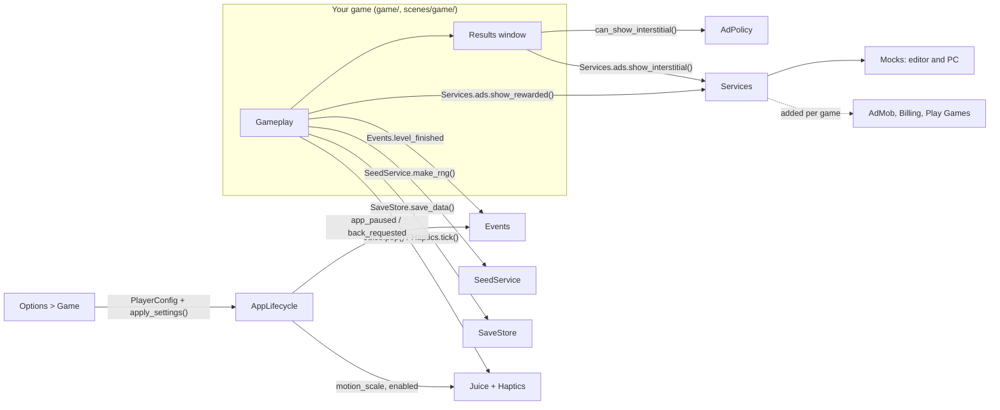

# Architecture

## What this template is for

A small studio shipping many small 2D portrait games on Android. The template holds everything
every game needs except the game itself, so each new game starts at gameplay instead of setup.
Its rules come from the studio's October 2026 research: casual puzzle games funded mostly by ads,
built for low-end phones, judged on retention, with no AI-generated art.

**Principles**
1. **Game code never talks to a platform SDK directly.** It calls interfaces in `Services`; a mock
   or a real plugin sits behind them. The whole game loop runs on PC, and a dead plugin can be
   swapped without touching games.
2. **Call down, signal up.** Parents call methods on children; children and systems emit signals;
   anything crossing systems goes through the `Events` bus.
3. **Rules that are easy to get wrong live in tested code**, not in memory: when ads may show
   (`AdPolicy`), stable seeds (`SeedService`), safe saving (`SaveStore`).
4. **Low-end Android first:** Compatibility renderer, 720×1280 canvas, 96 px touch targets, cheap
   effects, nothing timed to audio.
5. **Respect the player:** Reduce Motion and Haptics settings, no interstitials in the first
   session, no loot boxes.

## Folder map

```
core/                  Template systems shared by every game (ours)
  events.gd            Autoload Events: global signal bus
  app_lifecycle.gd     Autoload AppLifecycle: Android pause/resume/Back, feel settings
  services/            Autoload Services + interfaces + mocks
  ad_policy.gd         When an interstitial may show (pure logic)
  seed_service.gd      Stable SHA-256 seeds
  save_store.gd        Versioned JSON save
  feel/                Juice (tweens), Haptics, hit_flash.gdshader
  ui/                  mobile_theme.tres, SafeAreaMargin
  dev_tools.gd         Autoload DevTools: debug-only console commands
scenes/, scripts/,     Maaack's Game Template example content: menus, options, pause,
resources/, assets/    loading, credits, example game and levels. Yours to edit per game.
game/, data/           (create per game) gameplay code and baked level data
tests/                 GUT unit tests (test_*.gd)
tools/                 check.ps1, hooks/ (Claude Code auto-check), levelgen/ (per game)
addons/                Vendored plugins. Never edit.
.claude/               Claude Code settings (hook) and project skills
docs/                  These guides
```

## How the parts connect



## Autoloads (load order matters)

Defined in `project.godot`, in this order:

| Autoload | Source | Role |
|---|---|---|
| `SceneLoader` | Maaack | Scene changes with a loading screen |
| `ProjectMusicController` | Maaack | Music blending between scenes |
| `ProjectUISoundController` | Maaack | Button and UI sounds |
| `LimboConsole` | addon | The in-game console (disabled in release builds) |
| `Events` | `core/events.gd` | Signal bus |
| `Services` | `core/services/services.gd` | Service hub |
| `AppLifecycle` | `core/app_lifecycle.gd` | Lifecycle and feel settings (needs `Events`) |
| `DevTools` | `core/dev_tools.gd` | Console commands (needs all of the above; frees itself in release) |

## Module reference

### Events (`core/events.gd`)
Signals only; any script can emit or connect.

| Signal | Emitted by | Typical listener |
|---|---|---|
| `level_started(level_id: String)` | gameplay | analytics, music |
| `level_finished(level_id: String, won: bool, stars: int)` | gameplay | progress, `AdPolicy.record_level_result()` |
| `results_shown(level_id: String, won: bool)` | results window | ad slot |
| `reward_granted(reward_id: String, amount: int)` | reward code | HUD |
| `setting_changed(key: StringName, value: Variant)` | settings code | anything that reacts to settings |
| `app_paused`, `app_resumed` | `AppLifecycle` | **save progress on `app_paused`** (Android can kill a paused app) |
| `back_requested` | `AppLifecycle` | open the pause menu / go back one screen |
| `debug_command(command: StringName, args: Array)` | `DevTools` | your game's debug hooks (`set_seed`, `skip_level`) |

```gdscript
func _ready() -> void:
	Events.app_paused.connect(_save_progress)
	Events.debug_command.connect(_on_debug_command)
```

### Services (`core/services/`)
`Services.ads`, `.iap`, `.analytics`, `.leaderboard`, `.review`. Details and how to plug in real
SDKs: [SERVICES.md](SERVICES.md).

```gdscript
Services.ads.rewarded_finished.connect(_on_rewarded)
Services.ads.show_rewarded("revive")
Services.analytics.log_event("first_win", {"level": 1})
```

### AppLifecycle (`core/app_lifecycle.gd`)
- Turns `NOTIFICATION_APPLICATION_PAUSED / RESUMED` and `NOTIFICATION_WM_GO_BACK_REQUEST` into
  `Events` signals. `project.godot` sets `application/config/quit_on_go_back=false`, so Back no
  longer quits the app.
- `apply_settings()` reads `GameSettings/ReduceMotion` and `GameSettings/Haptics` from Maaack's
  `PlayerConfig` (`user://player_config.cfg`) and sets `Juice.motion_scale` and `Haptics.enabled`.
  It runs at start, on resume, and when the Options > Game toggles change.
- **Verify on a device:** Maaack's pause menu opens on the `ui_cancel` action (Esc on PC). If the
  Android Back button does not open it on your phone, connect `Events.back_requested` to your pause
  logic in the game scene.

### AdPolicy (`core/ad_policy.gd`)
Pure logic, unit-tested. Create one per game session and ask it before every interstitial.

```gdscript
var ad_policy := AdPolicy.new()

func _ready() -> void:
	ad_policy.start_session(session_index)   # persist and increment session_index in your save
	Events.level_finished.connect(func(_id: String, won: bool, _stars: int) -> void:
		ad_policy.record_level_result(won))

# Call when the results window opens, after the win animation:
func _on_results_shown(level: int, won: bool) -> void:
	var now := Time.get_ticks_msec() / 1000.0
	if ad_policy.can_show_interstitial(level, won, now) and Services.ads.is_interstitial_ready("results"):
		ad_policy.record_interstitial_shown(now)
		Services.ads.show_interstitial("results")
```

Defaults: no interstitials in session 1, none before level 8, none after a loss, at least 2 won
levels and 120 s apart, at most 3 per session, none within 60 s of a rewarded ad, none in daily or
zen modes (`ritual_mode = true`). Call `record_rewarded_shown(now)` after rewarded ads.
Tune per game in [CUSTOMIZING.md](CUSTOMIZING.md).

### SeedService (`core/seed_service.gd`)
`make_seed(parts, gen_version) -> int` and `make_rng(parts, gen_version) -> RandomNumberGenerator`.
SHA-256 based, so the same parts give the same seed on every machine; whole floats from JSON
(`3.0`) hash like ints. Godot's RNG algorithm may change between engine versions, so **bake shipped
levels to data files** and only generate disposable content at runtime (see the
`level-generation` skill).

### SaveStore (`core/save_store.gd`)
`save_data(data: Dictionary, path := "user://save.json") -> Error`, `load_data(path) -> Dictionary`,
`delete_save(path)`. Writes to a temp file, then replaces the save, so a crash mid-write never
corrupts it. Every save carries a `version`; bump `CURRENT_VERSION` and add a step to `_migrate()`
when the layout changes. A corrupt file loads as a fresh save with a warning.

**SaveStore vs Maaack's GameState:** Maaack's `GameState`/`LevelState` (in `scripts/`) drive the
example menus (Continue, level select) and save as Resource files, which his own docs warn can
carry injected scripts. Use **SaveStore for your game's progress, coins and settings**; keep or
remove Maaack's state as the example menus need.

### Juice and Haptics (`core/feel/`)
- `Juice.pop(node, peak := 1.08, duration := 0.12)` and `Juice.squash(node, scale := Vector2(1.12, 0.9), duration := 0.14)`
  return a `Tween` (or `null` when reduced motion is on). Retriggering mid-effect restores the
  node's rest scale first, so rapid taps never leave nodes enlarged. Set `pivot_offset` on Controls.
- `Haptics.tick()` (12 ms), `.success()` (40 ms), `.big()` (80 ms), `.pulse(ms, amplitude)`.
  Mobile only; needs the VIBRATE permission (on in both presets).
- `hit_flash.gdshader`: set `flash` once with `set_shader_parameter`, then tween
  `"shader_parameter/flash"` from 1 to 0. One material per flashing node.

### Mobile UI (`core/ui/`)
- `mobile_theme.tres` is the project theme (`gui/theme/custom`): 32 px default text, buttons padded
  to about 96 px tall, toggle tap areas 96 px.
- `SafeAreaMargin` (a `MarginContainer`): put HUDs and menus inside it; on phones it adds margins
  for notches and system bars. `extra_margin` adds padding everywhere.

### DevTools (`core/dev_tools.gd`)
Debug builds only. Open the console with `` ` `` on PC or a three-finger tap on a phone.
Commands: `set_seed <text>`, `skip_level`, `ads_grant <true|false>`, `motion <0..1>`,
`reset_save`, plus LimboConsole's built-ins (`help`, `commands`, `fps_max`, ...). Your game reacts
to `set_seed` and `skip_level` through `Events.debug_command`.

## Design decisions

| Decision | Why |
|---|---|
| Godot 4.7.2 pinned | 4.7 targets API 36 by default (Google Play requirement since 31 Aug 2026); 4.6.0 does not |
| Compatibility renderer | Godot's docs call it "usually good enough for 2D" and safest on low-end phones |
| Mocks behind interfaces | Play the whole loop on PC; swap plugins without touching games; mocks do nothing in release builds |
| JSON SaveStore | JSON cannot carry scripts, unlike Resource saves |
| Baked levels | Seeds alone are not stable across engine updates; players must never see a level change |
| Strict ad rules | A game living on organic installs depends on day-1 retention; Play bans ads at level start or during play |
| GitHub, one repo per game | Unlimited private repos and template repos on the free plan |
| No AI-generated assets | Studio rule; player sentiment in paying markets is negative |
