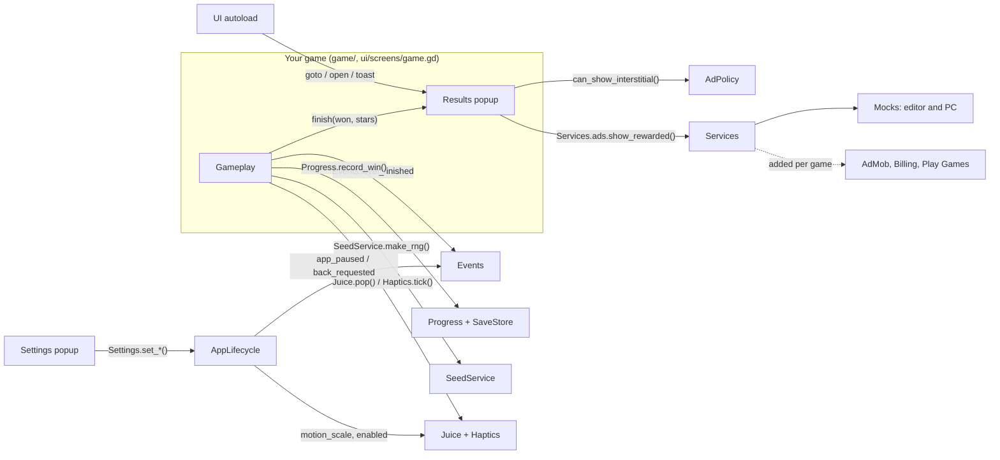

# Architecture

## What this template is for

A small studio shipping many small 2D portrait games on Android. The template holds everything
every game needs except the game itself, so each new game starts at gameplay instead of setup.
Its rules come from the studio's October 2026 research: casual puzzle games funded mostly by ads,
built for low-end phones, judged on retention, with no AI-generated art.

**Principles**
1. **Game code never talks to a platform SDK directly.** It calls interfaces in `Services`; a mock
   or a real plugin sits behind them. The whole game loop runs on PC, and a dead plugin can be
   swapped without touching games.
2. **Call down, signal up.** Parents call methods on children; children and systems emit signals;
   anything crossing systems goes through the `Events` bus.
3. **Rules that are easy to get wrong live in tested code**, not in memory: when ads may show
   (`AdPolicy`), stable seeds (`SeedService`), safe saving (`SaveStore`).
4. **Low-end Android first:** Compatibility renderer, 720 px wide canvas, 96 px touch targets, cheap
   effects, nothing timed to audio.
5. **Respect the player:** Reduce Motion and Haptics settings, no interstitials in the first
   session, no loot boxes.

## Folder map

```
core/                  Template systems shared by every game (ours)
  events.gd            Autoload Events: global signal bus
  app_lifecycle.gd     Autoload AppLifecycle: Android pause/resume/Back, feel settings
  services/            Autoload Services + interfaces + mocks
  ad_policy.gd         When an interstitial may show (pure logic)
  seed_service.gd      Stable SHA-256 seeds
  save_store.gd        Versioned JSON save
  progress.gd          Stars, unlocks, coins, purchases, daily streak (uses SaveStore)
  settings.gd          Volume, vibration, reduce motion
  feel/                Juice (tweens), Haptics, hit_flash.gdshader
  ui/                  The UI kit: autoload UI, Screen, Modal, layout containers, widgets,
                       styles/ (5 UIStyle resources), themes/ (built), fonts/, icons/
  dev_tools.gd         Autoload DevTools: debug-only console commands
ui/                    Screens (ui/screens/) and popups (ui/popups/) of the game. Yours to edit
scenes/                Maaack's loading screen (for SceneLoader, heavy scenes only)
assets/template_icon/  Placeholder app icon (replace per game)
game/halves/           Halves: pure logic (faces, geometry, state, fill, solver, bots, levels)
                       and the board view (tiles, snap effect, shards). See HALVES.md
data/levels/           Baked Halves levels (halves_v1.json), made by tools/levelgen/
tests/                 GUT unit tests (test_*.gd)
tools/                 check.ps1, snapshots, build_theme.gd, scene_edit.gd, hooks/ (Claude Code auto-check)
addons/                Vendored plugins. Never edit.
.claude/               Claude Code settings (hook) and project skills
docs/                  These guides
```

## How the parts connect



## Autoloads (load order matters)

Defined in `project.godot`, in this order:

| Autoload | Source | Role |
|---|---|---|
| `SceneLoader` | Maaack | Scene changes with a loading screen |
| `ProjectMusicController` | Maaack | Music blending between scenes |
| `ProjectUISoundController` | Maaack | Button and UI sounds |
| `LimboConsole` | addon | The in-game console (disabled in release builds) |
| `Events` | `core/events.gd` | Signal bus |
| `Services` | `core/services/services.gd` | Service hub |
| `AppLifecycle` | `core/app_lifecycle.gd` | Lifecycle and feel settings (needs `Events`) |
| `UI` | `core/ui/ui.gd` | Screen changes, popups and Back, toasts, styles, button feel (needs the above) |
| `DevTools` | `core/dev_tools.gd` | Console commands (needs all of the above; frees itself in release) |

## Module reference

### Events (`core/events.gd`)
Signals only; any script can emit or connect.

| Signal | Emitted by | Typical listener |
|---|---|---|
| `level_started(level_id: String)` | gameplay | analytics, music |
| `level_finished(level_id: String, won: bool, stars: int)` | gameplay | progress, `AdPolicy.record_level_result()` |
| `results_shown(level_id: String, won: bool)` | results window | ad slot |
| `reward_granted(reward_id: String, amount: int)` | reward code | HUD |
| `setting_changed(key: StringName, value: Variant)` | settings code | anything that reacts to settings |
| `app_paused`, `app_resumed` | `AppLifecycle` | **save progress on `app_paused`** (Android can kill a paused app) |
| `back_requested` | `AppLifecycle` | open the pause menu / go back one screen |
| `debug_command(command: StringName, args: Array)` | `DevTools` | your game's debug hooks (`set_seed`, `skip_level`) |

```gdscript
func _ready() -> void:
	Events.app_paused.connect(_save_progress)
	Events.debug_command.connect(_on_debug_command)
```

### Services (`core/services/`)
`Services.ads`, `.iap`, `.analytics`, `.leaderboard`, `.review`. Details and how to plug in real
SDKs: [SERVICES.md](SERVICES.md).

```gdscript
Services.ads.rewarded_finished.connect(_on_rewarded)
Services.ads.show_rewarded("revive")
Services.analytics.log_event("first_win", {"level": 1})
```

### AppLifecycle (`core/app_lifecycle.gd`)
- Turns `NOTIFICATION_APPLICATION_PAUSED / RESUMED` and `NOTIFICATION_WM_GO_BACK_REQUEST` into
  `Events` signals. `project.godot` sets `application/config/quit_on_go_back=false`, so Back no
  longer quits the app.
- `apply_settings()` reads `GameSettings/ReduceMotion` and `GameSettings/Haptics` from Maaack's
  `PlayerConfig` (`user://player_config.cfg`) and sets `Juice.motion_scale` and `Haptics.enabled`.
  It runs at start, on resume, and when the Settings toggles change (through `Settings`).
- **Back on Android:** Godot delivers the Back button as a `KEY_BACK` key event plus the
  go-back notification. `project.godot` maps `KEY_BACK` to `ui_cancel` (next to Escape), so popups
  and screens handle Back, Escape and the gamepad the same way (see [UI_KIT.md](UI_KIT.md)).
  Checked on a OnePlus 10R (Android 15) with `adb shell input keyevent 4` and the `log_input`
  console command.

### AdPolicy (`core/ad_policy.gd`)
Pure logic, unit-tested. Create one per game session and ask it before every interstitial.

```gdscript
var ad_policy := AdPolicy.new()

func _ready() -> void:
	ad_policy.start_session(session_index)   # persist and increment session_index in your save
	Events.level_finished.connect(func(_id: String, won: bool, _stars: int) -> void:
		ad_policy.record_level_result(won))

# ui/screens/game.gd does this when the results popup opens:
func _on_results_shown(level: int, won: bool) -> void:
	var now := Time.get_ticks_msec() / 1000.0
	if ad_policy.can_show_interstitial(level, won, now) and Services.ads.is_interstitial_ready("results"):
		ad_policy.record_interstitial_shown(now)
		Services.ads.show_interstitial("results")
```

Defaults: no interstitials in session 1, none before level 8, none after a loss, at least 2 won
levels and 120 s apart, at most 3 per session, none within 60 s of a rewarded ad, none in daily or
zen modes (`ritual_mode = true`). Call `record_rewarded_shown(now)` after rewarded ads.
Tune per game in [CUSTOMIZING.md](CUSTOMIZING.md).

### SeedService (`core/seed_service.gd`)
`make_seed(parts, gen_version) -> int` and `make_rng(parts, gen_version) -> RandomNumberGenerator`.
SHA-256 based, so the same parts give the same seed on every machine; whole floats from JSON
(`3.0`) hash like ints. Godot's RNG algorithm may change between engine versions, so **bake shipped
levels to data files** and only generate disposable content at runtime (see the
`level-generation` skill).

### SaveStore (`core/save_store.gd`)
`save_data(data: Dictionary, path := "user://save.json") -> Error`, `load_data(path) -> Dictionary`,
`delete_save(path)`. Writes to a temp file, then replaces the save, so a crash mid-write never
corrupts it. Every save carries a `version`; bump `CURRENT_VERSION` and add a step to `_migrate()`
when the layout changes. A corrupt file loads as a fresh save with a warning.

**Progress** (`core/progress.gd`) is the template's player progress on top of SaveStore: best stars
per level, unlocks, coins, owned items and the daily reward streak, saved on every change. It
replaces Maaack's `GameState` (removed), which saved Resource files that can carry injected
scripts. Tests point `Progress.path` at a temporary file. Its re-read function is
`load_from_disk()`: a static function named `reload()` would be shadowed by `Script.reload()`.

### Juice and Haptics (`core/feel/`)
- `Juice.pop(node, peak := 1.08, duration := 0.12)` and `Juice.squash(node, scale := Vector2(1.12, 0.9), duration := 0.14)`
  return a `Tween` (or `null` when reduced motion is on). Retriggering mid-effect restores the
  node's rest scale first, so rapid taps never leave nodes enlarged. Set `pivot_offset` on Controls.
- `Haptics.tick()` (12 ms), `.success()` (40 ms), `.big()` (80 ms), `.pulse(ms, amplitude)`.
  Mobile only; needs the VIBRATE permission (on in both presets).
- `hit_flash.gdshader`: set `flash` once with `set_shader_parameter`, then tween
  `"shader_parameter/flash"` from 1 to 0. One material per flashing node.

### UI kit (`core/ui/`, `ui/`)
Six styles (the template's five plus `halves`; `core/ui/styles/*.tres`, built into
`core/ui/themes/` by `tools/build_theme.gd`), the `UI` autoload, `Screen` and `Modal` base classes,
responsive containers, widgets and the game's screens and popups (plus Halves' booster popup).
Everything is in [UI_KIT.md](UI_KIT.md).

### Halves (`game/halves/`, `ui/screens/game.gd`, `tools/levelgen/`)
The game: rules, data formats, the logic API and how to regenerate levels are in
[HALVES.md](HALVES.md). `Progress.start_session()` (called by the splash once per launch) feeds
`AdPolicy.start_session()` so the first session stays free of interstitials.

### DevTools (`core/dev_tools.gd`)
Debug builds only. Open the console with `` ` `` on PC or a three-finger tap on a phone.
Commands: `set_seed <text>`, `skip_level`, `ads_grant <true|false>`, `motion <0..1>`,
`reset_save`, `fps` (FPS, frame time, draw calls, memory overlay), `log_input` (print every key,
touch and action event), `display_info`, `safe_area <l> <t> <r> <b>` (fake a notch), plus LimboConsole's built-ins (`help`, `commands`, `fps_max`, ...). Your game reacts
to `set_seed` and `skip_level` through `Events.debug_command`.

## Design decisions

| Decision | Why |
|---|---|
| Godot 4.7.2 pinned | 4.7 targets API 36 by default (Google Play requirement since 31 Aug 2026); 4.6.0 does not |
| Compatibility renderer | Godot's docs call it "usually good enough for 2D" and safest on low-end phones |
| Mocks behind interfaces | Play the whole loop on PC; swap plugins without touching games; mocks do nothing in release builds |
| JSON SaveStore | JSON cannot carry scripts, unlike Resource saves |
| Baked levels | Seeds alone are not stable across engine updates; players must never see a level change |
| Strict ad rules | A game living on organic installs depends on day-1 retention; Play bans ads at level start or during play |
| GitHub, one repo per game | Unlimited private repos and template repos on the free plan |
| No AI-generated assets | Studio rule; player sentiment in paying markets is negative |
| Own UI kit instead of Maaack's menus | Maaack's menus are desktop-first (narrow centred buttons, tabs, small popups); the kit is built for thumbs, notches and tablets, and every screen is checked by tests |
| Styles as resources plus a builder | One Inspector-editable file per style; the builder guarantees every component exists in every style, and tests check every style's contrast and touch sizes |
| SVG icons and switch art as `DPITexture` | Sharp at any screen density without shipping several bitmap sizes |
| Back key mapped to `ui_cancel` | One code path for Android Back, Escape and gamepads; popups get it first |
| No `override.cfg` | Godot applies it on the PC but it is not exported, so the PC and the phone would differ |
| Own splash and icon, credits as text | The launch shows the game, not the tools; Godot and Maaack are credited in the credits with their full licence texts, which MIT requires |
| TouchScrollContainer for lists | Godot's ScrollContainer only scrolls on touch where no control takes the press, so button and text lists felt stuck on phones (found in a device test) |
