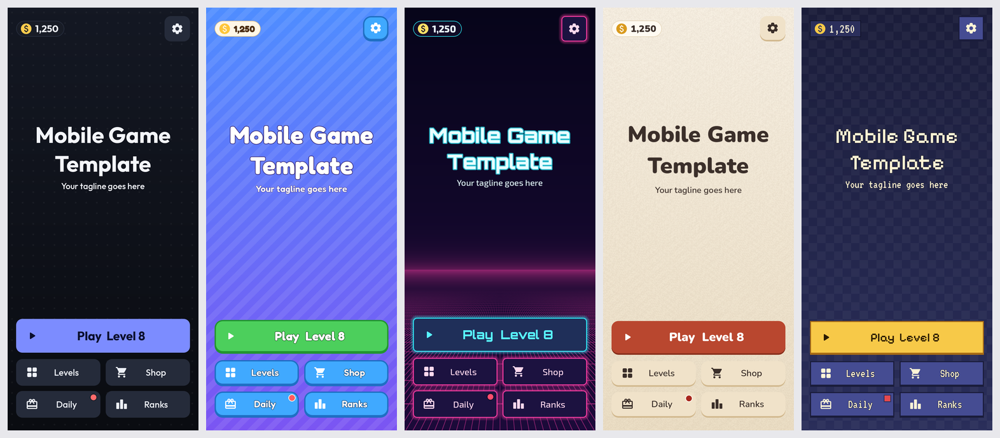

# UI kit

The template ships a complete set of mobile game screens in **five visual styles**. Every screen
is built once from theme types and tokens, so switching the style restyles all of them. Layouts
adapt to every phone shape, foldables and tablets (portrait).



## Screens and popups

| | File | What it does |
|---|---|---|
| Splash | `ui/screens/splash.tscn` | Halves: over the home screen's photo, two half tiles slide in and snap into the Halves mark with a burst, then the name rises in (about 2 s, tap to skip) |
| Main menu | `ui/screens/main_menu.tscn` | Over its own photo (Mount Fuji) with a slow drift and a soft shade at top and bottom: coins, Records and Settings on top, the Halves mark and title high up, then the big **Play** button (next unbeaten level) with a square **Levels** button beside it, and Daily, Zen and Rush (locked until levels 10 and 15) in one row. Back asks before quitting |
| Journey (level select) | `ui/screens/level_select.tscn` + `journey_path.gd` | A Crest Book card on top, then per place a header card (thumbnail, name, stars and Swift medals; tap for the photo) and, once reached, its twenty levels as stepping stones on a winding dotted trail (best stars, locks, ⚡). Places ahead show only a locked card. The next stone breathes and is scrolled into view; dev mode opens everything |
| Crest Book | `ui/screens/crest_book.tscn` | A page per place: each won level's crest whole on an ivory card, the rest as faint outlines with their level number; tap a crest for its name |
| Game | `ui/screens/game.tscn` | Halves in four modes over the place's soft photo with a mat under the board: HUD (pause, title, chapter and clock, progress bar, stars), the board, hint/undo/shuffle boosters and Mend once earned, the stuck card (undo, mend or shuffle), tip cards, and the end flow (results, chapter reveal). Bold tiles and the left-handed layout apply live |
| Credits | `ui/screens/credits.tscn` | Built from `ATTRIBUTION.md` (your game first, then what it is made with), followed automatically by the licence notices the shipped code requires. Links are plain text |
| UI kit gallery | `ui/screens/ui_gallery.tscn` | Every component on one page with a live style switcher (Settings > Open the UI kit gallery, debug builds) |
| Pause | `ui/popups/pause_popup.tscn` | Resume, restart, How to play (every tip card), settings, main menu, quick music/sound/vibration toggles. Pauses the game |
| Tip | `ui/popups/tip_popup.tscn` | One rule with a tiny board drawn by the real tiles (`setup(id)`), or every rule paged (`setup_all()`) |
| Chapter | `ui/popups/chapter_popup.tscn` | A place's photo (or drawn version) with its location and photo credit, its stars and medals; shown when its ten levels are completed |
| Daily | `ui/popups/daily_popup.tscn` | Today's Daily Puzzle: number, weekday difficulty, a 7-day strip, streak, best time, Play, Copy result |
| Results | `ui/popups/results_popup.tscn` | Win (`show_win(level, stars, coins, details)`): stars pop in with rising chimes, the time counts up against par and best, New best / Swift / Gold / Combo ribbons, coins count up, Next (rush shows its score; daily shows the streak and Copy result). Lose: "+5 moves (watch ad)", Retry, Home. Back does not dismiss it |
| Settings | `ui/popups/settings_popup.tscn` | Three groups: Sound (music and sound volume, music style chips: Lo-fi, Calm, Rain, Nature, Focus), Look and feel (Photos or Drawn backgrounds, vibration, reduce motion with a one-line explanation, show timer) and More (credits, privacy policy, reset progress, version). Debug builds add Developer: dev mode, Show FPS and the style picker |
| Confirm | `ui/popups/confirm_popup.tscn` | Yes/no question, `await UI.confirm(...)` |
| Records | `ui/popups/ranks_popup.tscn` | The player's own stats and bests: stars, levels, coins, Swift medals, rush best and daily streak (Halves v1 has no online leaderboard) |

The flow: Android launch screen (app icon) → splash → main menu → (level select) → game → results → next / retry / home.
All paths are in `ui/screens.gd` (`Screens.MAIN_MENU`, `Screens.PAUSE`, ...).

## The five styles

| Style | Look | Fonts | Good for |
|---|---|---|---|
| `sleek_dark` (default) | Calm dark slate, periwinkle accent, soft shadows, dot pattern | Outfit | Puzzle, zen, strategy |
| `candy_casual` | Bright blue-purple, chunky 3D buttons with outlined text, cream cards, moving stripes | Fredoka | Casual, match-3, kids-adjacent (13+) |
| `neon_arcade` | Synthwave grid, glowing outline buttons that fill when pressed | Orbitron titles, Exo 2 text | Arcade, rhythm, action |
| `cozy_paper` | Warm cream paper grain, terracotta accent, soft edges | Nunito | Word, cozy, card, relaxing |
| `pixel_retro` | Square corners, hard borders, checker pattern | Pixelify Sans | Retro, platformer, roguelike |
| `halves` (this game's default) | Cobalt gradient, ivory text, sand primary buttons, still dot pattern | Outfit | Halves: the concept palette (ivory, cobalt, terracotta, teal, sand) |

The five template styles stay in the repo; `halves` is the sixth and the project theme. Its
palette also lives, for the board art only, in `game/halves/halves_palette.gd`.

**Pick your game's style:** Project Settings > GUI > Theme > Custom → `res://core/ui/themes/<id>.tres`.
That is the default every screen uses. `UI.apply_style(&"candy_casual")` switches at runtime (the
debug-only picker in Settings and the gallery use it, and remember the choice in
`user://player_config.cfg`). To let players choose, turn on `show_style_picker` in
`settings_popup.gd`.

**Leaving unused styles out of a release:** the five fonts add about 0.5 MB to the APK. Delete the
styles you do not use (their `core/ui/styles/<id>.tres`, `core/ui/themes/<id>.tres` and fonts), then
run the tests.

## Making your own style

1. Duplicate a file in `core/ui/styles/` and give it a new `id`. Edit it in the Inspector: colours,
   fonts (any `.ttf` with an open licence; log it in `ASSETS_LICENSES.md`), button shape (Flat,
   Chunky, Outline, Pixel), corner radii, shadow, background pattern.
2. Build the themes: `godot --headless --path . -s tools/build_theme.gd`
3. Check it: `powershell -ExecutionPolicy Bypass -File tools/check.ps1`. `test_theme.gd` fails if any
   text is below WCAG AA contrast or any control is under 48 dp.
4. Look at it: `powershell -ExecutionPolicy Bypass -File tools/snapshots.ps1 -Styles your_id`
   and open `build/snapshots/your_id_*_contact.png`.

`tools/build_theme.gd` is the design system: it turns a style's tokens into every button, card,
slider and switch. Edit it to change how all styles draw a component. Hand edits to the generated
files in `core/ui/themes/` are lost on the next build.

## Theme types (use these, not per-node overrides)

Set a control's **Theme Type Variation** in the Inspector (or `theme_type_variation` in code).

| Kind | Types |
|---|---|
| Buttons | `Button` (secondary), `AccentButton` (primary), `HeroButton` (the one big action), `DangerButton`, `GhostButton` (text only), `IconButton` and `AccentIconButton` (square 96 px, icon only), `TileButton` and `AccentTileButton` (grid tiles), `ChipButton` (toggle chips) |
| Labels | `TitleLabel` (logo-size, on the background), `ScreenHeaderLabel` (screen titles on the background), `HeaderLabel` (titles on cards), `OnBgLabel` (body text on the background), `CaptionLabel` (secondary text on cards), `ValueLabel` (numbers), `BadgeLabel` |
| Panels | `PanelContainer` (card), `SheetPanel` (popups), `TilePanel`, `HighlightPanel` (accent border), `PillPanel` (counters), `BadgePanel`, `DotPanel` (notification dot), `ToastPanel`, `BarPanel` (invisible) |
| Controls | `HSlider`, `CheckButton` (switch), `ProgressBar`, scroll bars: styled automatically |

Text on the background and text on cards use different types because the colours differ in light
and dark styles. **Tokens** hold the raw values for code and custom drawing:

```gdscript
var accent := get_theme_color(&"accent", &"Tokens")         # any Control
var gold := UI.get_theme_color_safe(&"gold")                 # from non-Control code
var touch := get_theme_constant(&"touch_target", &"Tokens")  # 96
```
Colours: `bg_top`, `bg_bottom`, `text_on_bg`, `surface`, `surface_border`, `text`, `text_muted`,
`raised`, `text_on_raised`, `accent`, `on_accent`, `gold`, `positive`, `danger`, `scrim`.
Constants: `touch_target`, `hero_height`, `gap`, `screen_margin`, `radius`, `panel_radius`.
Font sizes: `small`, `body`, `header`, `title`. Fonts: `display`, `body`.

## Building blocks

| Piece | File | Use |
|---|---|---|
| `UI` autoload | `core/ui/ui.gd` | `goto(path)` (fade), `open(scene) -> Modal`, `await confirm(title, message, ok, destructive)`, `toast(text, icon)`, `apply_style(id)`, `list_styles()`, `has_modal()`, `close_all()`. Also gives every button a press squash and a haptic tick, shows focus rings only after keyboard or gamepad input, and draws a side icon next to centred button text (not at the edge) |
| `Screen` | `core/ui/screen.gd` | Base for full screens. Back calls `on_back()`; or set `back_scene` |
| `Modal` | `core/ui/modal.gd` | Base for popups: dimmed backdrop, pop-in, Back and backdrop taps close it when `dismissible`, `pauses_game`, `sheet_max_width`, `await popup.closed` for the result. A `%Scroll` inside the sheet scrolls when the content is taller than the screen |
| `StyledBackground` | `core/ui/styled_background.gd` | Gradient and animated pattern from the style; stops moving with Reduce Motion |
| `SafeAreaMargin` | `core/ui/safe_area_margin.gd` | Keeps content clear of the camera hole and gesture bar |
| `TouchScrollContainer` | `core/ui/touch_scroll_container.gd` | Use for every scrolling list: scrolls when a drag starts on buttons or text too, never presses the button it started on, and flicks keep gliding (Godot's own ScrollContainer only scrolls where nothing takes the press) |
| `MaxWidthContainer` | `core/ui/max_width_container.gd` | Centred column with a maximum width (tablets) |
| `AdaptiveGridContainer` | `core/ui/adaptive_grid_container.gd` | Grid whose column count follows its width |
| `StarRating`, `CurrencyPill`, `LevelTile` | `core/ui/widgets/` | Stars (with `reveal()`), counters (with `set_value()` count-up), level tiles |
| `Icons` | `core/ui/icons.gd` | 38 Material Symbols icons, e.g. `Icons.PLAY`, `Icons.COIN` |
| `Progress` | `core/progress.gd` | Stars per level, unlocks, coins, purchases, daily streak (JSON save) |
| `Settings` | `core/settings.gd` | Volume, vibration, reduce motion (read and save) |

## Adding a screen

1. Duplicate `ui/screens/credits.tscn` (and its script) as a starting point. The layout every screen
   uses:
   ```
   YourScreen (Control, full rect, script extends Screen)
   ├── Background   (ColorRect + StyledBackground)
   └── Safe         (SafeAreaMargin, extra_margin 32)
       └── Column   (MaxWidthContainer, max_width 680-960)
           └── Layout (VBoxContainer): header row, content (TouchScrollContainer if it can grow), bottom actions
   ```
2. Add its path to `ui/screens.gd`, open it with `UI.goto(Screens.YOUR_SCREEN)`.
3. Add it to `PAGES` in `tests/test_screens.gd` and `SCREENS` in `tools/snapshots.gd`.

## Adding a popup

1. Duplicate `ui/popups/confirm_popup.tscn`: root Control with a script that `extends Modal`,
   then `Safe` (SafeAreaMargin) → `Center` (CenterContainer) → `%Sheet` (`SheetPanel`). Set
   `mouse_filter` to Ignore on Safe and Center, so taps on the backdrop reach it.
2. Open it and wait for the answer:
   ```gdscript
   var choice: Variant = await UI.open(load(Screens.YOUR_POPUP) as PackedScene).closed
   ```
3. Add it to the tests and snapshots as above.

## Layout rules

- **Canvas:** 720 px wide on phones (2 px = 1 dp on a 360 dp phone); heights run from 1280 (16:9) to
  about 1700 (21:9). Tablets and foldables get a wider canvas (about 960-1100 px), not a taller one.
- **Touch targets:** at least 96 px (48 dp) both ways. The theme makes every button, switch and slider
  that big; `test_screens.gd` checks every screen at three sizes.
- **Thumb zone:** the main action in the bottom third; pause and rare actions at the top.
- **One primary action per screen** (accent or hero colour); everything else secondary.
- **Safe areas:** every screen sits in a `SafeAreaMargin`. Your phone (OnePlus 10R) has a 96 px
  camera hole at the top centre and a 48 px gesture bar (64 and 32 px on the canvas).
- **Wide screens:** content in a `MaxWidthContainer`; grids in an `AdaptiveGridContainer`.
- **Text:** 32 px body (16 dp), 26 px minimum for captions; numbers use `ValueLabel`.
- **Colour:** never the only signal (switches also change knob size, locked levels show a lock).

## Back button

Android Back arrives as the `ui_cancel` action (the Back key is mapped in Project Settings > Input
Map, next to Escape and the gamepad button). Order of handling:
1. The top popup closes if it is `dismissible` (the results popup is not; the player must choose).
2. Otherwise the current `Screen.on_back()` runs: level select, credits and gallery go to the
   main menu, the game opens pause, the main menu asks before quitting.

`Events.back_requested` is still emitted for analytics or custom code.

## Feedback and motion

Every button gets a press squash (to 95%) and a 12 ms haptic tick automatically. Reduce Motion
turns the squash, popup pop-ins, logo intro, Play button breathing, star pops, coin count-ups and
background drift off; the haptic tick follows the Vibration setting. Opt a button out with
`button.set_meta(&"ui_feedback", false)`.

## Checking UI changes

| Check | How |
|---|---|
| Contrast and touch sizes of every style | `tests/test_theme.gd` (part of `tools/check.ps1`) |
| Every screen at 3 sizes: size, on-screen, no overlap | `tests/test_screens.gd` |
| Look at it | `tools/snapshots.ps1` writes every screen × style × size to `build/snapshots/`, plus one contact sheet per style and size. Flags: `-Styles all`, `-Sizes 720x1600`, `-Only "main_menu,pause"`, `-Inset "0,64,0,32"` (fake notch and gesture bar) |
| On the phone | Settings > Open the UI kit gallery; console commands `safe_area`, `display_info`, `fps` |

Snapshots use a separate demo save, so your PC progress is untouched.

## Known limits

- No in-game text-size setting yet (word games should add one).
- Screen readers: Godot's Android TalkBack support lands in Godot 4.8.
- Text is not set up for translation (strings are in the scenes and scripts).
- The pixel font is drawn smoothed: a canvas scaled to the phone's resolution cannot line up with a
  pixel grid, and unsmoothed it turned "3" and "5" into "8" and "S".
- Halves v1 is free with no shop, ads or purchases; the services stay as mocks (see
  [SERVICES.md](SERVICES.md)) until a later version adds them.
